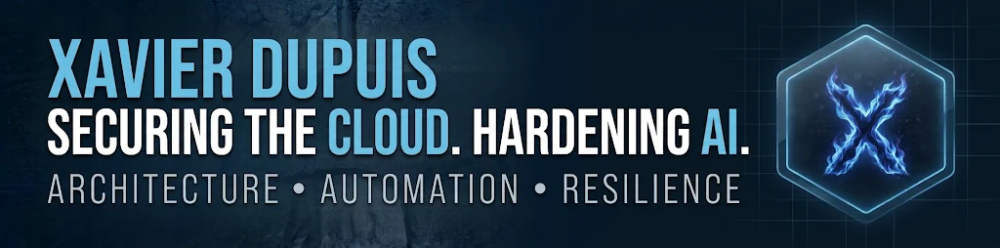

  

<h2 align="center">💼 Senior Cybersecurity Advisor | Cloud & AI Security</h2>

  I help organizations secure cloud and AI systems, 
  and I build projects on AWS to test what I advise.

  
  
  
  
  

  📍 Greater Montréal, Canada &nbsp;•&nbsp; 🌐 English / Français

---

## What I focus on

| ☁️ Cloud security | 🤖 AI security | 🛡️ Resilience |
|---|---|---|
| AWS architecture, automation, infrastructure drift detection | Attacking and hardening AI agents, guardrails, prompt injection defense | Security that keeps working when things break |

---

## Featured projects

### 🏦 [InnovaBank: AI Agent Security](https://github.com/Xav519/innovabank-ai-agent-security)
A fictional banking AI agent deployed in two versions, **vulnerable** and **hardened**, with the same automated attack bench run against both. Covers prompt injection, RAG poisoning, tool abuse and data leakage, then measures the before/after results with real runs.

`AWS` `Terraform` `Amazon Bedrock Guardrails` `IAM` `CloudWatch` `OWASP` `MITRE ATLAS`

### ⚛️ [SOC Quantum Optimizer](https://github.com/Xav519/aws-quantum-finance-AI)
A hybrid quantum-classical tool that assigns SOC analysts to threats. Built around quantum-readiness, not hype: it runs QAOA on Amazon Braket and uses Claude on Amazon Bedrock for the reasoning layer.

`Amazon Braket` `QAOA` `Amazon Bedrock` `Python`

### 🔁 [AWS Drift Detection & Remediation](https://github.com/Xav519/aws-DriftDetection-Remediation)
Detects infrastructure drift in AWS and fixes it automatically, so the live environment always matches the code.

`Terraform` `GitHub Actions` `AWS Lambda` `DynamoDB`

---

## Credentials

- AWS Certified Security Specialty
- AWS Certified Solutions Architect Associate
- CompTIA Security+ / Network+
- Associate of (ISC)², CISSP exam passed (certification pending required work experience)
- Top 1% globally on [TryHackMe](https://tryhackme.com/p/Xav519)

---

## Let's connect

  

  🐧 <i>Linux: it runs infinite loops in 5 seconds.</i>

